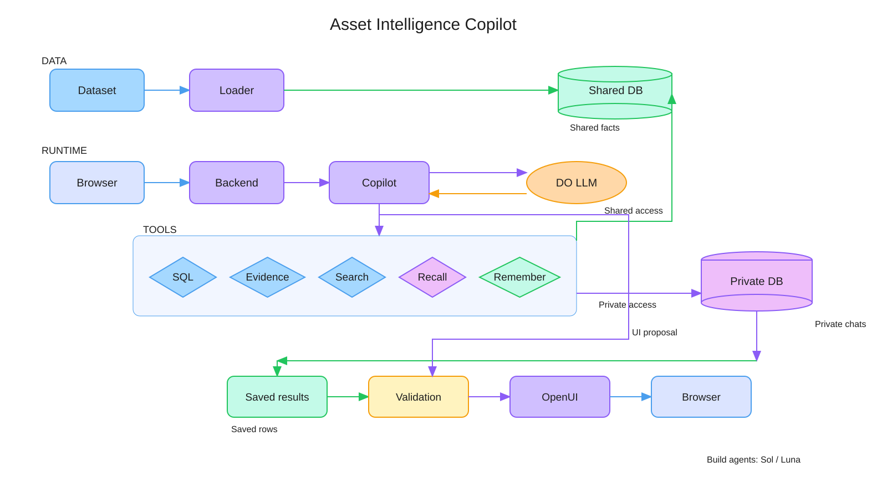

# Asset Intelligence Copilot

A local chat application for the FlytBase asset-intelligence challenge. FastAPI and SQLite combine well records, operating documents, operator notes and private conversation history. React and OpenUI render result-backed cards, tables, charts, maps and heatmaps with inspectable evidence.

The final dataset contains **600 wells across seven areas**, with calculations anchored to **15 January 2027**. The latest completed full evaluation produced **two source-supported answers across 21 turns**. This is a prototype with substantial remaining reliability limits; returned HTTP responses are not accuracy passes.

## Start locally

Requirements: Python 3.11+, Node 22.12+ and npm. From a fresh application checkout:

```sh
python3 -m venv .venv
.venv/bin/python -m pip install -r requirements.txt
npm --prefix frontend ci
```

Obtain the separate official dataset if `dataset/` is absent:

```sh
git clone https://github.com/FlytBaseAILabs/flytbase-ahc-swe-asset-intelligence-dataset.git dataset
git -C dataset checkout 009e2b5
```

Create `.env` from `.env.example` **only if `.env` does not already exist**. Set your DigitalOcean model access key in `GRADIENT_MODEL_ACCESS_KEY`. Never commit the key. The demo settings are:

```dotenv
LLM_BASE_URL=https://inference.do-ai.run/v1
LLM_MODEL=inference-router
LLM_ROUTING_PREFERENCE=budget
ANALYSIS_DATE=2027-01-15
LLM_CALL_TIMEOUT_SECONDS=90
ANSWER_TIMEOUT_SECONDS=240
```

Load a fresh knowledge database and start the backend:

```sh
.venv/bin/python -m app.load dataset/test-data/dataset --db data/knowledge.sqlite
.venv/bin/python -m uvicorn app.main:app --host 127.0.0.1 --port 8000
```

In a second terminal:

```sh
npm --prefix frontend run dev
```

Open [the chat](http://127.0.0.1:5173), select a user and start a new conversation. API documentation is at [localhost:8000/docs](http://127.0.0.1:8000/docs); readiness and the calculation date are at `/api/health`. The backend reads `.env`; existing shell environment values take precedence. Restart it after configuration changes. Node and the installed frontend dependencies are also required by the backend's native OpenUI validator.

An existing sample database must be backed up before replacement: the final release revises older records. Follow the [release runbook](docs/released-data.md). The loader rejects conflicting IDs; do not overwrite or delete private memory to resolve them.

## How an answer travels



The runtime splits into three layers: a **loader** that validates and merges source records into a shared SQLite database, a **copilot loop** that calls five read-only tools against that database via a DigitalOcean-hosted model, and a **browser** that renders server-validated OpenUI components backed by saved query results. Shared knowledge (corrections, well facts, rules) lives in one database; private chats, tool traces and result rows live in a second database the analytics connection cannot open.

1. The loader validates source records and stores originals, rules and searchable documents in `data/knowledge.sqlite`.
2. The API checks the selected user and conversation. The model can call five tools: `run_sql`, `get_evidence`, `search_documents`, `memory_read` and `remember`.
3. Restricted read-only SQL calculates from approved views. Shared corrections retain provenance; original measurements remain available. Source rules and operator notes determine the applicable interpretation.
4. Private chats, tool traces and saved query results live in `data/memory.sqlite`. Private lookups are owner-checked; analytics SQL cannot read that database.
5. The model proposes native OpenUI. Server validation checks allowed components, result ownership, revision, columns and values. The browser renders saved rows, rather than model-authored data arrays.

The user picker is a **demo identity mechanism**, not production authentication. Keep both services on loopback. Streaming and public deployment authentication are not implemented. Sol/Luna are build-time workers; the product uses one runtime copilot loop.

See the [system design](docs/system-design.md), [contracts](docs/contracts.md), [architecture SVG](docs/diagrams/video-system.svg) and [editable Excalidraw](docs/diagrams/video-system.excalidraw).

## Evaluation and limitations

The final questions are in the official dataset's `test-data/final-questions.md`. The completed **E4** rerun asked all 11 questions and their follow-ups in order, using one isolated shared state and user-private conversations, with one attempt per turn:

- 21 turns captured: 12 HTTP 200 partial responses and nine provider errors caused by upstream HTTP 400 responses; no HTTP 504 timeout occurred.
- Ten partial responses stopped at the application context limit.
- Q1 returned a supported refusal to invent reservoir-pressure measurements. Q9 turn 2 correctly named Nathan Pierce and 150 Northwest Production wells.
- The other 19 turns did not produce verifiable answers. No general accuracy percentage or complete-suite pass is claimed.

The [E4 report](tasks/reports/E4-final-rerun.md) records the outputs, limitations and usage lower bound. [Independent source checks](tasks/reports/E4-source-oracles.md) provide reference results; they are not copilot answers. Earlier runs remain separate.

A post-context-change evaluation is currently in progress. At the write-up snapshot, 16/21 turns had been attempted: 11 partial HTTP 200 responses, four HTTP 502 errors, and one pending request. These interim responses have not completed evidence review, so the counts do not establish improved accuracy. Its private captures are under ignored `data/evaluations/context-pipeline-final/`. To start a fresh run in a new workspace, use `python3 scripts/evaluate_context_pipeline.py --run`; use `--resume` only for an existing interrupted run. It makes paid inference calls and does not change the active database.

After E4, the provider request was changed to retain tool definitions while using `tool_choice: none` for final synthesis. That repair has offline test evidence, not a post-fix full-suite score. A later context repair bounds tool previews, deduplicates search excerpts, supports evidence paging, and compacts older tool cycles at72,000 characters while keeping saved results and source references. It passed a realistic offline replay and 75 focused checks. A subsequent single Q4 check returned in 180.7 seconds without a context-limit failure or timeout, but both final drafts failed JSON validation; no usable table was returned. This is not an answer-quality pass. The E4 results must not be presented as a test of these later changes. Increasing timeouts does not solve context growth. No automatic provider retries or model fallbacks are enabled. The development proxy waits up to 300 seconds.

## Checks

```sh
.venv/bin/python -m pytest -q tests/test_provider.py tests/test_agent.py tests/test_store.py
npm --prefix frontend run check:openui
npm --prefix frontend run build
```

Offline tests use scripted providers and temporary databases. They check behavior and safeguards, not live answer accuracy. `scripts/check_backend_question.py` and evaluation scripts use the configured paid provider; do not run them as part of an ordinary offline test command. Saved evaluations fence attempts against automatic replay.

## Submission files

- [Two-page write-up PDF](submission/asset-intelligence-writeup.pdf): system design with the SVG on page 1; completed E4 results and a clearly labeled in-progress evaluation snapshot on page 2. The PDF pagination has been checked.
- [Editable Word companion](submission/asset-intelligence-writeup.docx): the same content; Word/Google Docs pagination may vary.
- [Video pitch script](submission/pitch-script.md) and [upload instructions](submission/UPLOAD-README.md).
- The local `submission/flytbase-submission.zip` additionally contains all 21 captured answers, visual specifications, saved result rows and reports. This ZIP is intentionally ignored by Git; it excludes keys, runtime databases and private tool traces.

Upload the PDF to Drive and use its share link in the write-up field. Record the narrated video separately, at most five minutes. The ZIP contains no video. Final portal submission is a manual user action.

Runtime data, credentials, private conversations, dependency folders and local inspection artifacts stay out of this repository. Models used at runtime and incomplete token usage are recorded where available; no measured dollar total is claimed. [DigitalOcean configuration details](docs/digitalocean.md) remain available for setup and troubleshooting.
