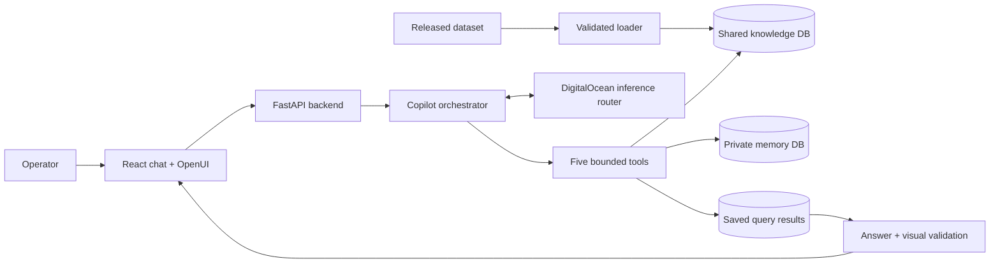

# Asset Intelligence Copilot

## Page 1 — System design

**Purpose.** Give field operators answers from well inspections, maintenance reports, manuals and operating procedures, while keeping each answer traceable to its source. The released dataset contains 600 wells across seven areas. Calculations use the challenge’s date of **15 January 2027**.



**How a question is answered.** The browser sends a question and its selected demo user to the FastAPI backend. One runtime copilot loop calls the DigitalOcean inference router and can use five bounded tools: `run_sql` for approved read-only calculations; `get_evidence` for source records; `search_documents` for manuals and SOPs; `memory_read` for permitted conversation memory; and `remember` for accepted scoped corrections or preferences. The model cannot run arbitrary SQL outside approved views or execute generated browser code.

**How data stays traceable.** The loader keeps original records, checks relationships and indexes the released manuals. Shared operational facts live in `knowledge.sqlite`; private conversations live in a separate `memory.sqlite`. The backend binds memory reads to the selected user and thread. Accepted corrections are stored separately from original readings and only affect their stated scope. Each SQL result is saved with its rows and source references before it can be used in an answer or visual.

**How answers and visuals are checked.** The model proposes a response and an OpenUI description. The server checks the answer schema, evidence references, user ownership, dataset revision and visual component/result references. Tables and charts point to saved query results, so displayed numbers come from stored rows rather than model-authored arrays. Invalid answers return a safe explanation instead of an unverified visual.

**Boundary.** The user selector is for a local demonstration; it is not production authentication. Sol and Luna were used as build-time orchestrator/workers. The shipped app has one runtime copilot, not a multi-agent runtime.

---

<div style="page-break-after: always"></div>

## Page 2 — Final evaluation outputs

**Run:** `context-pipeline-final` · **Dataset:** `dataset-7207fefc8284` · **Date:** 2027-01-15 · **Turns:** 21/21 attempted once on an isolated database and private-memory copy.

### Machine-readable result summary

```yaml
http_200_partial: 13
http_502_no_answer: 8
http_504_timeout: 0
explicit_context_limit_errors: 0
answer_schema_or_citation_failures: 7
sql_repair_failures: 1
provider_errors:
  invalid_response_format: 5
  model_unavailable_for_account_tier_403: 2
  rate_limit_or_credit_429: 1
independently_source_supported: [Q1, Q9-2]
provisional_saved_result_supported: [Q8-3, Q9-1]
accuracy_percentage: null
```

**Interpretation.** Compared with the earlier E4 run (10 context-limit partials and 9 upstream errors), this run had no explicit context-limit response or 504. It still returned eight provider errors and seven answer-validation/citation failures. Two outputs were independently verified against source records. Two recall outputs matched their saved query results but were not independently scored against a separate oracle. This is not a broad accuracy score; HTTP 200 `partial` is not a correctness pass.

### Per-turn outputs

| Test | Observed output | Evidence / verdict |
|---|---|---|
| Q1 | Refused to map reservoir pressure because no reservoir-pressure measurements exist; offered a field-status map alternative. | **Supported refusal.** 9 citations; consistent with the source-data check. |
| Q2 | No answer; clarification failed the answer validator because it included factual content. | **Failed validation.** No result to assess. |
| Q3 | No answer; provider returned an invalid response format (HTTP 502). | **Provider failure.** No table to assess. |
| Q4 | No answer; final citation references could not be resolved. | **Failed validation.** No bypass table returned. |
| Q5 | No answer; final response did not match schema for `limitations`. | **Failed validation.** No compliance table returned. |
| Q6 | No answer; SQL query failed after one repair attempt. | **Query failure.** No disagreement table returned. |
| Q7-1 | No answer; provider returned an invalid response format (HTTP 502). | **Provider failure.** No ranked repair list. |
| Q7-2 | No answer; final response did not match schema for `limitations`. | **Failed validation.** No crew recommendation. |
| Q8-1 | No answer; final response did not match schema for `limitations`. | **Failed validation.** Evaluation database stayed at revision 1; no shared correction was recorded. |
| Q8-2 | Acknowledged U-601’s sorting, cost-format and citation preferences; stated private-memory persistence failed. | **Partial.** Preferences were not confirmed as durable memory. |
| Q8-3 | Listed nine recalled pumps still in the ground and nine already replaced; returned a native OpenUI table and saved maintenance results. | **Provisional.** 38 citations and complete saved results; not independently oracle-scored. |
| Q8-4 | No answer; provider returned an invalid response format (HTTP 502). | **Provider failure.** No shared-claim conflict response to assess. |
| Q8-5 | No answer; provider returned an invalid response format (HTTP 502). | **Provider failure.** No area/cost table. |
| Q9-1 | Reported nine recalled pumps across four areas (4 Northwest, 2 Southwest, 2 Northeast, 1 Southeast); returned a native OpenUI table. | **Provisional.** 22 citations and saved query results; not independently oracle-scored. |
| Q9-2 | Named Nathan Pierce as Northwest Production lead and reported 150 wells; returned two OpenUI cards. | **Supported.** 4 citations; independently checked against team, user and asset records. |
| Q9-3 | No answer; cited references could not be resolved. | **Failed validation.** No cold-weather SOP answer. |
| Q9-4 | No answer; cited references could not be resolved. | **Failed validation.** No Dec 3 H2S answer. Source records contain no reading for that date. |
| Q9-5 | No answer; provider returned an invalid response format (HTTP 502). | **Provider failure.** No production/repair follow-up. |
| Q9-6 | No answer; provider returned HTTP 403 because the model was unavailable for the account tier. | **Provider failure.** No priority recommendation. |
| Q10 | No answer; provider returned HTTP 403 because the model was unavailable for the account tier. | **Provider failure.** No area table or stacked bar chart. |
| Q11 | No answer; provider returned HTTP 429 rate-limit/credit error. | **Provider failure.** No regional comparison. |

**Reproducibility and privacy.** Run with `python3 scripts/evaluate_context_pipeline.py --run`; the one-attempt run state, prompts, responses, query results and isolated databases are saved under the ignored `data/evaluations/context-pipeline-final/`. Do not replay completed turns. The active demo database was not changed. The captured usage totals **1,988,031 tokens**; failed calls may omit usage, so this is a lower bound. No dollar cost is inferred.

**Sources:** [Completed E4 report](https://github.com/shipitdev/hackbase/blob/main/tasks/reports/E4-final-rerun.md) · [Independent source checks](https://github.com/shipitdev/hackbase/blob/main/tasks/reports/E4-source-oracles.md) · [Context engineering change report](https://github.com/shipitdev/hackbase/blob/main/tasks/reports/R5-context-fix.md) · [Latest run status](context-pipeline-status.md).
